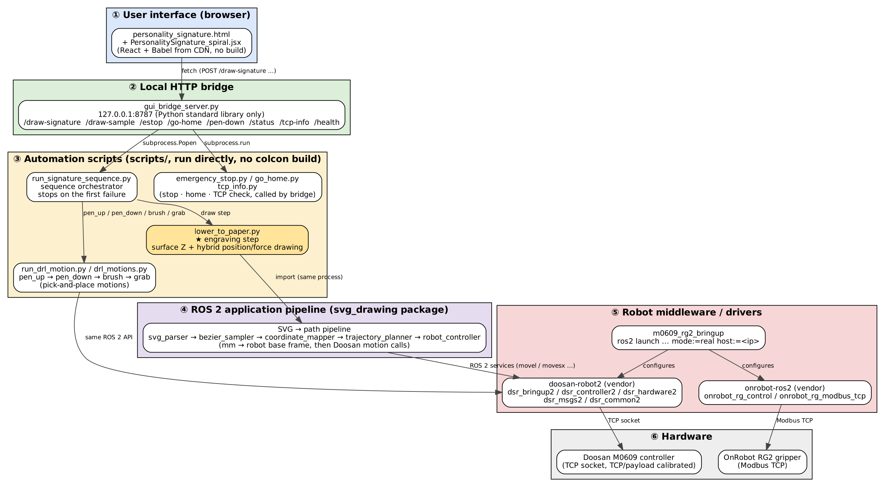
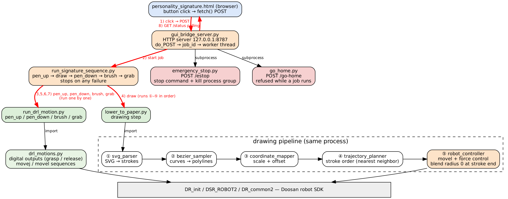

# Robotic Drawing System (SIGNATURE)

A Doosan M0609 collaborative arm engraves a personal pattern into an acrylic panel with a steel scriber, using hybrid position/force control. A user answers a short personality survey in a web page, the page generates a pattern as SVG, and the robot picks up the pen, engraves the pattern, returns the pen, brushes off the dust, and hands over the finished panel.

ROKEY Robotics Bootcamp team project (5 people), July 2026. Built and demonstrated on hardware.

> Korean version of this README: [README.ko.md](README.ko.md). The detailed developer guide ([DEVELOPMENT.md](DEVELOPMENT.md)) and user manual ([사용설명서.md](사용설명서.md)) are in Korean.

## Team

| Member | Role |
|---|---|
| Yongjun Yu | Team lead; 3D modeling and printing of fixtures (pen gripper, panel holder, tool holder) |
| **Gene Woo Lim** | Position/force control, safety checks (TCP check, contact detection), drawing sequence, gripper interlock and grasp logic, SVG-to-path conversion, pattern algorithm, GUI–robot bridge |
| Hyunjun Jeon | Scribing algorithm, code integration, system architecture |
| Taenam Kim | Motion improvements (output size, closing closed shapes), documentation |
| Seongwoo Park | Product planning |

## System overview

<p align="center"></p>

```
Browser GUI (personality_signature.html)
   │  survey → pattern → [Draw with robot]
   │  HTTP POST to 127.0.0.1:8787
   ▼
scripts/gui_bridge_server.py        local HTTP bridge (standard library only)
   ▼
scripts/run_signature_sequence.py   runs each step, stops on the first failure
   ├─ pen_up    pick up the pen (grasp checked over Modbus)
   ├─ draw      lower_to_paper.py: engrave the SVG
   ├─ pen_down  return the pen
   ├─ brush     brush off the dust (grasp checked over Modbus)
   └─ grab      pick up the finished panel and hand it over
```

Drawing pipeline (`svg_drawing/`):

```
svg_parser → bezier_sampler → coordinate_mapper → trajectory_planner → robot_controller
SVG paths    2 mm sampling,    SVG units → mm      stroke order to       motion with
             RDP simplify      on the panel        reduce travel         force control
```

<p align="center"></p>

## Main engineering problems

Values below are the defaults in the code (`scripts/lower_to_paper.py`, `svg_drawing/robot_controller.py`).

### 1. Even line depth: hybrid position/force control
With position control only, line depth changed across the panel, because the surface height and the set height were off by fractions of a millimeter. X and Y use position control (stiffness 3000) for the shape; Z uses force control (stiffness 10) to follow the surface.

Tests showed the left side of the panel needed more force than the right. The target force changes linearly across the panel, from 5.0 N on the right (Base −Y) to 7.0 N on the left (Base +Y). Compliance mode is turned on once per stroke, and after that only the target force is updated. Re-setting compliance mode in the middle of a motion made the robot stop without an error, so this was changed.

### 2. Faint stroke starts: force ramp wait
The arm started moving before the force reached its target, so the start of each stroke was faint. After force control turns on, the robot waits `force_ramp_wait_s` (2.0 s) before drawing.

### 3. Slow curves: RDP and angle-based blending
Curves are many short segments, and the arm slowed down at each point. Points are simplified with RDP (0.15 mm tolerance). The blend radius is set from the turn angle: corners of 25° or more keep 0.8 mm so shapes stay sharp; gentle curves use up to 4.0 mm. Slow zones of 6 mm (34% speed) at the start and end of each stroke are measured by distance, with an inserted point at the exact boundary.

### 4. Closed shapes and stroke ends
Start and end points matched in the math, but the arm missed by about 1 mm, so closed shapes did not close. Each stroke is extended along its last direction (`draw_extend_frac`, 1.5% in `lower_to_paper.py`).

### 5. Surface height: touch-off
The `/touch_off` service lowers the pen slowly until contact and stores the real surface Z. It stops after a max travel or timeout, and ignores contact in the first part of the travel so the pen's own weight does not trigger it.

### 6. Safety checks
| Check | How |
|---|---|
| Wrong TCP | Before any motion, `tcp_check.py` reads the active TCP. If the offset is outside 289 mm ± 20 mm (for example reset to the flange after a controller reboot), the run stops. |
| No panel / no contact | On the first stroke, the Z force is sampled and the median is compared to `no_contact_force_n` (4.0 N). With no contact, force control is released, the arm moves to a safe pose and the run ends with `NoContactError`. |
| Pen or brush not grasped | A closed gripper command does not prove an object was grasped. The gripper's Modbus register 275 is read: about 5 empty, about 200 with the pen, about 254 with the brush; below 80 means "not grasped". The gripper opens, the arm goes to its ready pose, and the GUI shows a restart button. |
| Gripper signal order | Digital outputs are switched in a fixed order (DO1/3/4 off, then DO2 on). The reverse order briefly triggered the wrong gripper rule. |

## Hardware

| Item | Notes |
|---|---|
| Doosan Robotics M0609 | 6-axis collaborative arm |
| OnRobot RG2 | Gripper; digital outputs for commands, Modbus TCP for grasp check |
| Steel scriber in a 3D-printed holder | TCP offset about 289 mm |
| Brush | Removes dust after engraving |
| Acrylic panel | Default 112.5 mm square |

## Software

- Ubuntu 22.04, ROS 2 Humble, Python 3.10
- Doosan ROS 2 driver (`dsr_bringup2`, `dsr_msgs2`), installed separately
- Python: `svgelements`, `numpy`, `pymodbus`
- GUI: React 18 and Babel from a CDN, no build step

## Setup

```bash
# ROS 2 Humble and the Doosan driver workspace must already be set up
cd ~/ws_cobot_pjt/ws_dsr/src
git clone <this repository> svg_drawing
pip install svgelements numpy pymodbus
cd ~/ws_cobot_pjt/ws_dsr
colcon build --packages-select svg_drawing
source install/setup.bash
```

## Usage

```bash
# Terminal A: robot driver (try mode:=virtual first on a new setup)
source /opt/ros/humble/setup.bash
source ~/ws_cobot_pjt/ws_dsr/install/setup.bash
ros2 launch m0609_rg2_bringup bringup.launch.py mode:=real host:=192.168.1.100

# Terminal B: GUI bridge server
cd ~/ws_cobot_pjt/ws_dsr/src/svg_drawing/scripts
python3 gui_bridge_server.py --port 8787

# Then open personality_signature.html in a browser on the same computer.
```

Draw one SVG from the terminal without the GUI:

```bash
python3 scripts/lower_to_paper.py --svg samples/merkaba.svg
```

## Repository structure

```
svg_drawing/        core package: parser, sampler, mapper, planner, robot controller
scripts/            standalone scripts: drawing, motions, sequence, GUI bridge, safety checks
config/             drawing parameters
launch/             ROS 2 launch file (service-based path, optional)
samples/            test SVG patterns
personality_signature.html, PersonalitySignature_spiral.jsx   survey and pattern GUI
CHANGELOG_*.md      problem / cause / fix notes (Korean)
```

## Safety notes

- Stay at the robot while it draws; use the GUI stop button or the physical E-stop if anything looks wrong.
- After a controller restart, check the TCP and run at low speed first.
- The bridge server listens on 127.0.0.1 only. Do not expose it to a network.
